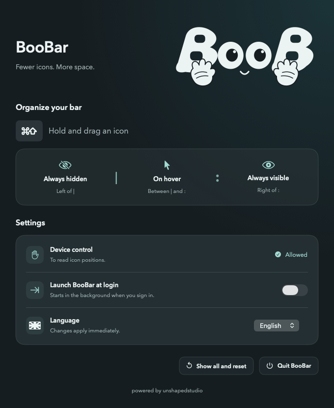

# BooBar

powered by [unshapedstudio](https://unshapedstudio.com/)

[English](#english) · [Italiano](#italiano)

## English

Hide the menu bar icons you rarely use. Three zones: **always visible, reveal on hover, always hidden**. Hold **⌘⇧** and drag icons to organize them.

### [Download DMG — Apple Silicon + Intel](https://github.com/marcovernetto-lgtm/BooBar/releases/download/v0.6.1/BooBar-0.6.1-universal.dmg)

Requires **macOS 27**. Open the DMG and drag **BooBar → Applications**. BooBar guides you through the required permission.

English/Italian. Optional launch at login. Right-click `:` to open settings.

---

## Italiano

Nascondi le icone che usi meno nella barra menu. Tre zone: **sempre visibili, al passaggio, sempre nascoste**. Tieni **⌘⇧** e trascina le icone per organizzarle.

### [Scarica DMG — Apple Silicon + Intel](https://github.com/marcovernetto-lgtm/BooBar/releases/download/v0.6.1/BooBar-0.6.1-universal.dmg)

Richiede **macOS 27**. Apri il DMG e trascina **BooBar → Applicazioni**. BooBar ti guida nel concedere il permesso necessario.

Italiano/inglese. Avvio al login facoltativo. Clic destro su `:` per aprire le impostazioni.
